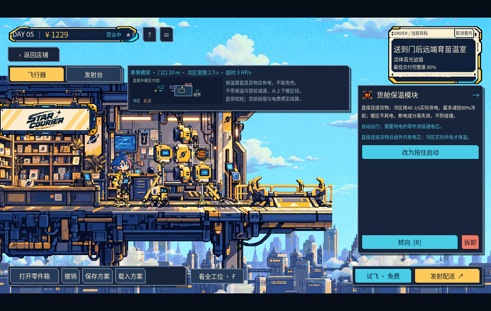
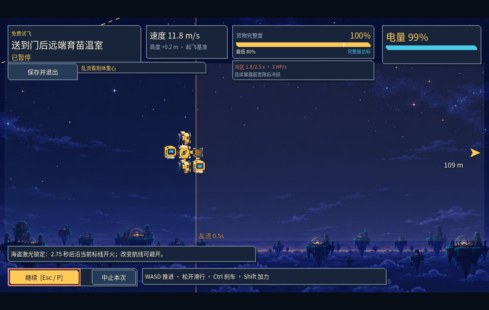

# 星际快递 · StarCourier

**[下载 Dev46 Windows x86_64 试玩版](https://github.com/lorcinv/star-courier/releases/download/dev46-demo/StarCourier-Dev46-Windows-x86_64-WIP.zip)** · [Release 页面](https://github.com/lorcinv/star-courier/releases/tag/dev46-demo)

私有仓库，下载需登录有访问权限的 GitHub 账号。

《星际快递》是一款物理组装配送游戏。接单后，用零件搭建飞行器和发射台，先免费试飞，再正式送货。Dev46 是开发中的试玩版（WIP），包含五关主线、剧情对白和 15 种在售配件。

## 开始试玩

1. 下载上方 Windows ZIP，完整解压。
2. 进入 `StarCourier-Dev46-Windows-x86_64`，运行 `StarCourier.exe`，保留同目录的全部文件。
3. 选择“新游戏”开始，或通过“继续游戏”读取存档。

免费试飞可反复尝试。每份订单有一次正式配送机会，按实际能耗、货损和零件损失结算。

## 实机画面

在工位布置零件，查看订单路线和风险。

穿过传送门后的寒区、乱流和海盗预警。

## 基本操作

- **装配**：鼠标选择零件，点击工位空位安装；拖动换位，`R` 旋转。中键平移，滚轮缩放，`F` 查看整个工位。
- **发射**：在“发射台”页调整角度和力度，再选择“试飞·免费”或“发射配送”。
- **飞行**：`WASD` 推进，松开滑行；`Ctrl` 制动，`Shift` 加力。
- **工具**：`Q` 切换，`Space` 使用。部分零件可在工位设置为自动或按住启动；固体助推器点火后持续燃烧，直至燃尽。
- **暂停和存档**：`Esc` 或 `P` 暂停，选择“保存并退出”保留进度，下次从“继续游戏”恢复。
- **对话**：`Enter` 或空格快显、继续，`Esc` 跳过。

## Dev46 的重点

第五关的新订单加入寒带路线，可选择保温直穿，或提前减速，从上下暖区绕行。旧已展示或已接受的订单保留原布局。

配件包括货舱保温模块、气动刹车板和一次点火的固体助推器，可以按货物和路线调整搭配。

## 打开工程

使用 Godot 4.6.3 打开 [project/project.godot](project/project.godot)。设计说明见 [project/PDR.md](project/PDR.md)。
